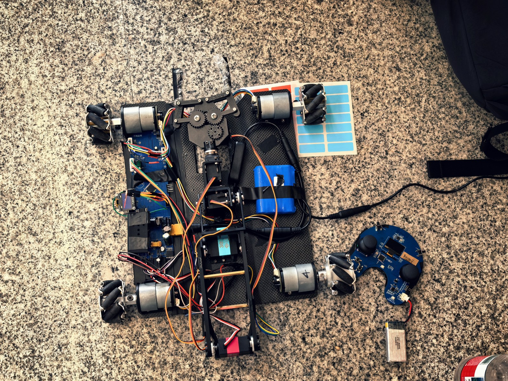
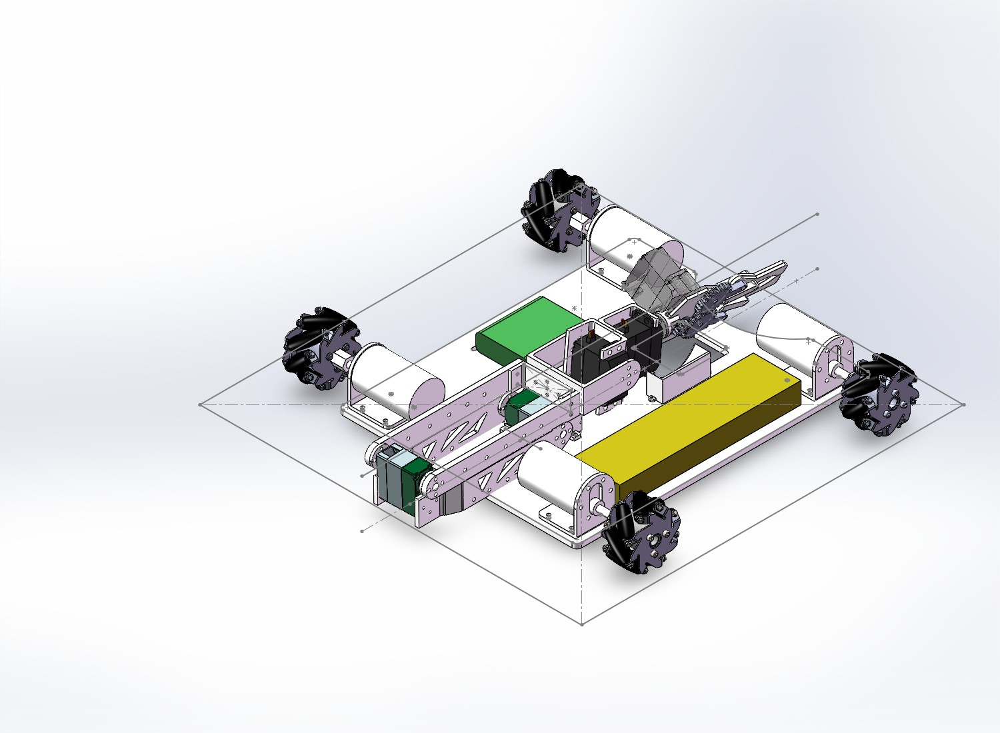

# 不晦启明 SRM小车

面向 RoboMaster Season 2027 校内赛的麦克纳姆轮取矿小车。项目已完成实车搭建与参赛，本仓库整理硬件、结构、嵌入式软件及调试复盘。

[最终交付](docs/最终交付.md) · [硬件图文](docs/硬件交付.md) · [照片与视频](docs/照片与演示.md) · [历史BOM](bom/README.md)

## 最终实现与比赛表现

以下实车结果由队伍提供：

- 支持无线遥控前进、后退、左右平移与旋转。
- 五路舵机机械臂可完成抓取、搬运和投放，支持预设动作与急停。
- OLED可显示电压、电流和功率。
- 练习时完成过三级兑矿，比赛时完成过二级兑矿。
- 比赛中出现无线控制不稳定和夹爪与旋转舵机之间的连接件断裂。功能完成不等于整车可靠性问题已经全部解决。
- 队伍反馈已实现规则要求的功能；本仓库记录实作与比赛结果，不代替裁判验收结论。

## 最终硬件版本

**实际参赛使用A板；B版作为备用，未在比赛中使用。** B版不能作为已经完成实战验证的版本。工程已归档至[备用B版目录](hardware/B-unverified/)，主要调整为元件布置更紧密、电源铺铜面积更大；这些是设计调整，尚无实测验证。

| 部分 | 方案 |
|---|---|
| 车控主控 | STM32F103RCT6 |
| 底盘 | 四轮麦克纳姆底盘、4路DRV8874及电机编码器 |
| 逻辑电源 | LM2596S-5.0：12V转5V；AP2112K-3.3：5V转3.3V |
| 舵机电源 | 两路XL4015，输出约6V |
| 舵机控制 | PCA9685，5只舵机（30kg、25kg及3只MG945） |
| 检测与显示 | INA226、采样电阻及OLED |
| 无线 | 外接兼容nRF24L01的模块，最终3.3V从调试模块引入 |

最终实物包含外接供电与飞线改动，早期原理图不能完整代表比赛时的接线。复现前需核对实物供电、共地及原供电支路隔离，避免多个稳压输出直接并联。

## 结构方案

采用低矮四轮麦克纳姆底盘，电子器件、电池与存矿区在底板上分区布置。机械臂以肩部、肘部舵机直连驱动，末端包含腕部俯仰、旋转和夹爪开合；删除底座回转机构，由车身转向分担朝向调整。主臂使用PLA打印主体，通过折返和末端旋转收纳减小通行占用空间。

最终使用30kg、25kg及3只MG945舵机。比赛中断裂的是夹爪与旋转舵机之间的连接件；队伍复盘认为横向堆积打印方向不合适，后续应按实际受力调整打印方向并验证。详见[结构报告](deliverables/最终交付_结构报告.docx)和[赛后复盘](docs/最终交付.md#结构交付)。

## 仓库目录

| 目录 | 内容 |
|---|---|
| [hardware/A-competition](hardware/A-competition/) | 实际参赛A版原理图与PCB资料 |
| [hardware/B-unverified](hardware/B-unverified/) | 备用B版EDA工程，未经验证、未参赛 |
| [deliverables](deliverables/) | 最终交付PPT、结构报告及文件版本说明 |
| [docs](docs/) | 最终交付说明、硬件图文、照片视频索引 |
| [bom](bom/) | BOM与材料清单原件、历史差异说明 |
| [assets](assets/) | 原理图/PCB图片、结构图片、照片和视频 |
| [software](software/) | 车控与遥控器软件工程 |

## 软件与操作说明

软件由吴欣然（[Wuxinran2007](https://github.com/Wuxinran2007)）上传和维护：

- [车控源码](software/Car_Control/)
- [遥控器源码](software/P02_remote_hal/)
- [小车说明：操作、任务架构、参数与引脚](software/Car_Control/小车说明.md)
- [遥控器说明：按键、模式、校准与协议](software/P02_remote_hal/遥控器说明.md)

现有车控工程包含CubeMX配置、CMake构建文件和FreeRTOS相关内容。软件说明列出电机、无线、机械臂和显示任务；SafetyTask未编写：队伍确认未安装板载急停按键和蜂鸣器，因此没有实现相应独立任务；已实现的遥控急停与失联处理由现有控制任务承担，不能与本地物理急停混同。本轮未重新编译、烧录或实机验证源码。

### 操作概要

最终采用底盘／机械臂两种模式。队伍确认信道和轴映射以车控版本为准；车控源码RF_CHANNEL为82，机械臂映射已对照arm_task.c确认：

| 模式 | 操作 |
|---|---|
| 底盘 | 右摇杆纵向控制前后、横向控制平移；左摇杆横向控制旋转 |
| 机械臂 | 右摇杆横向rx控制大臂、纵向ry控制小臂；左摇杆横向lx控制腕俯仰、纵向ly控制腕旋转 |
| 按键协议 | 急停、夹爪切换、模式切换、对孔、取矿、放矿 |

射频信道按车控版本为82；遥控端需保持一致，旧说明中的40不作为最终配置。具体物理按键与协议位映射仍参考遥控器代码，收到帧后的动作语义以车控实现为准。预设脉宽、关节限位与机械安装有关，不应直接复制到不同机构。

### 电源预算

中期出现过电池供电电流不足，最终通过软件限制动作和输出进行缓解。现有软件说明包含速度限幅、机械臂单轴选择及顺序预设动作。软件限制不会提高电池、接插件或PCB的物理承流能力。

**最终实装采样电阻为3mΩ（0.003Ω），已由硬件负责人确认。** 早期设计中的2mΩ不代表最终实物；INA226校准参数应按3mΩ核对。确认阻值不等于已经完成电流、功率测量精度校准。

## 调试与维修记录

| 现象 | 最终采取的处理 | 结论边界 |
|---|---|---|
| I²C通信不稳定 | 重焊SDA上拉电阻 | 记录处理结果，不据此认定所有通信故障均为同一原因 |
| 无线模块供电掉压 | 从调试模块引入3.3V，外接无线模块 | 比赛中仍出现无线不稳定 |
| U24相关低阻及电源掉压 | 重新焊接AP2112K和12V转5V模块 | 未通过独立失效分析确认唯一根因 |
| 中期供电电流不足 | 软件限制动作和输出 | 不等于硬件电流裕量增加 |
| 比赛中夹爪与旋转舵机之间的连接件断裂 | 队伍复盘归因为连接件采用横向堆积打印，而非竖向打印 | 打印方向为队伍报告的成因，未另行开展独立材料试验 |

### 无线不稳定的待验证因素

队伍初步怀疑：

1. 现场其他遥控设备（包括裁判遥控器）造成同频干扰；
2. 连接器或线缆接触不良；
3. 临时飞线的供电回路、固定和抗干扰措施不足。

**这些是候选因素，尚未通过信道抓包、供电波形或对照试验证实。** 不将现场其他设备写成已确认的责任方，也不把飞线本身视为必然失效原因。后续建议记录丢包率、供电波形和连接状态，逐项验证。

## 资料导航

| 内容 | 入口 |
|---|---|
| 车控软件 | [software/Car_Control](software/Car_Control/) |
| 遥控器软件 | [software/P02_remote_hal](software/P02_remote_hal/) |
| 软件使用说明 | [小车说明.md](software/Car_Control/小车说明.md) |
| A版原理图与PCB（参赛） | [A版_原理图与PCB.docx](hardware/A-competition/A版_原理图与PCB.docx) |
| 最终交付结构报告 | [最终交付_结构报告.docx](deliverables/最终交付_结构报告.docx) |

- [最终交付与参赛复盘](docs/最终交付.md)
- [硬件原理图、PCB及接口图片](docs/硬件交付.md)
- [照片与比赛／练习视频](docs/照片与演示.md)
- [原始最终交付PPT](deliverables/最终交付.pptx)
- [PPT逐页文字索引](docs/PPT文字索引.md)
- [历史BOM转录及采购差异](bom/README.md)：已包含10月26日PCB BOM及材料明细原件，10月7日版保留作历史记录。

原PPT中保留中期结构页、2mΩ和旧遥控映射等历史内容；以赛后确认及最终交付说明中的版本备注为准。软件资料中的射频信道和轴映射差异已按队伍确认，以车控版本为准整理，详见最终交付说明；原始PPT和软件源码未改动。

## 团队贡献

| 方向 | 贡献者 | 相关GitHub账号 |
|---|---|---|
| 硬件 | 雷理杰 | [AIYAA-1011](https://github.com/AIYAA-1011) |
| 软件 | 吴欣然 | [Wuxinran2007](https://github.com/Wuxinran2007) |
| 结构 | 顾翊天、周汐玥 | [gufranklin211-sudo](https://github.com/gufranklin211-sudo) |

## 复现提示

先验证电源与通信，再单独测试电机、舵机和组合动作。急停停止PWM并不必然切断舵机电源，机械臂失去保持力后的运动也需要实际验证。比赛版本存在已记录的无线与结构可靠性问题，复现时应将改进和验证一并安排。

