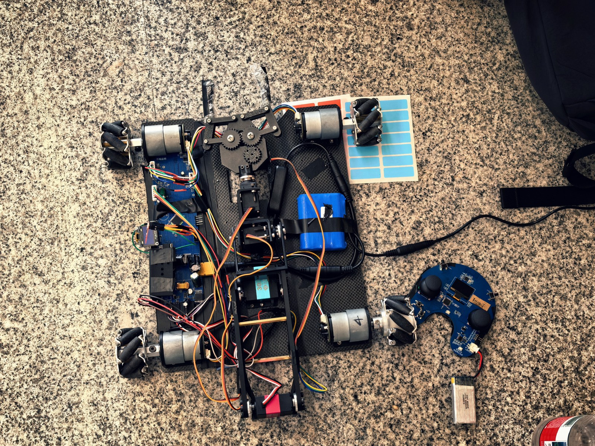
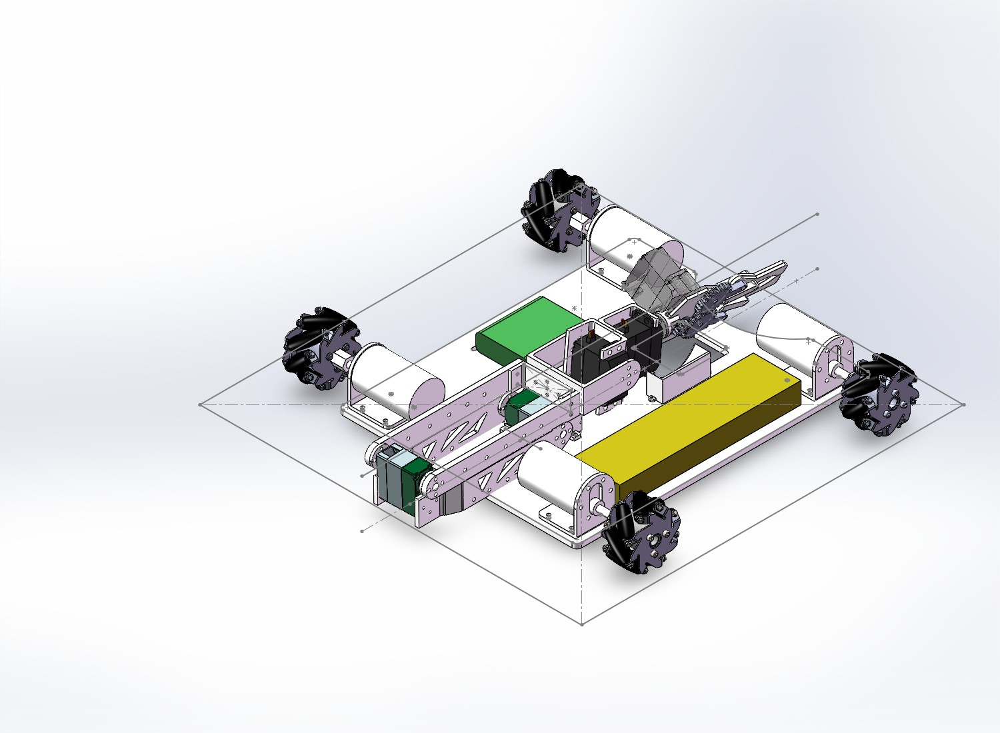
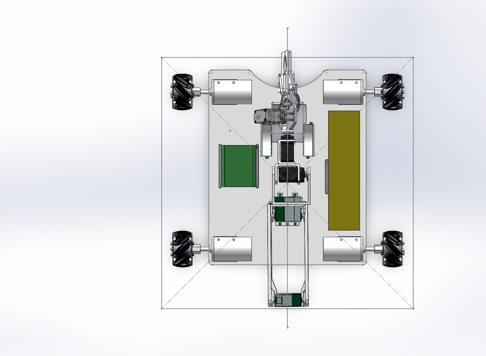

# 不晦启明队：最终交付与参赛复盘

本页依据队伍赛后确认、交付PPT、照片视频及仓库软件资料整理。记录更新于2026年11月2日。

## 结果

队伍确认：整车已实现规则要求的功能，支持遥控前后、左右平移及旋转；五舵机机械臂可正常作业，有预设动作和急停；OLED可显示电压、电流和功率。上述是队伍对完成情况的陈述，不将其写成独立的逐条规则认证。

| 场景 | 已完成/发生的事项 | 证据与边界 |
| --- | --- | --- |
| 练习 | 完成过三级兑矿 | 队伍确认；另提供练习视频，不能把视频中的每个动作自动标为三级判定成功 |
| 比赛 | 完成过二级兑矿 | 队伍确认；提供文件名为“比赛时候二级兑矿”的视频 |
| 比赛可靠性 | 无线控制存在不稳定 | 尚无射频抓包或供电波形证明唯一成因 |
| 比赛结构 | 夹爪与旋转舵机之间的连接件断裂 | 队伍复盘：采用横向堆积打印而非竖向打印；没有额外的独立材料试验 |

视频入口见[照片与演示](照片与演示.md)。文件名和队伍反馈不代替裁判现场认定。

## 版本与最终实物

- **A板实际参赛，B版作为备用但未在比赛中使用，未经验证。** [A版资料](../hardware/A-competition/)与[B版工程](../hardware/B-unverified/)分目录归档。
- 无线模块外接，3.3V从调试模块引入；飞线/外接供电属于比赛实物改动，不能仅凭早期原理图复原。
- 最终采样电阻为**3mΩ（0.003Ω）**，由硬件负责人确认。软件头文件也以3mΩ为接线假设；还需保证初始化实参及测量校准一致。
- 五只舵机最终确认为30kg、25kg及3只MG945。队伍已更正此前MG996R的口述，最终型号与PPT第27页一致。
- 中期供电电流不足通过软件限制动作和输出缓解。它不提高电池、走线或接插件的额定能力。

## 硬件方案与图纸

详见[硬件图文说明](硬件交付.md)。图纸和PCB截图从交付PPT提取，是设计资料，不保证包含全部赛前返修和飞线。

| 模块 | 方案 |
| --- | --- |
| 车控 | STM32F103RCT6 |
| 遥控 | STM32F103C8T6 |
| 四路电机 | DRV8874，各路独立控制，编码器反馈 |
| 五路舵机 | PCA9685经I²C2生成PWM；两路XL4015产生约6V |
| 逻辑电源 | LM2596S-5.0：12V转5V；AP2112K-3.3：5V转3.3V |
| 电源检测 | INA226、最终3mΩ采样电阻 |
| 无线 | Si24R1/nRF24L01兼容模块 |
| 显示 | OLED显示电压、电流、功率 |

## 软件交付

- [车控工程](../software/Car_Control/)
- [遥控器工程](../software/P02_remote_hal/)
- [小车说明](../software/Car_Control/小车说明.md)
- [遥控器说明](../software/P02_remote_hal/遥控器说明.md)

软件作者为吴欣然（[Wuxinran2007](https://github.com/Wuxinran2007)）。本次补充资料不修改软件实现，也未重新编译、烧录和实机回归。

车控按电机、无线、机械臂、显示划分任务，遥控负责输入采集、校准、打包和状态显示。预设动作包括过洞/归位、取矿、兑矿。最终使用双模式控制，PPT中的旧固定摇杆映射不应作为现行操作指南。

### 最终软件参数与资料版本

| 项目 | 当前发现 | 使用原则 |
| --- | --- | --- |
| 射频信道 | 队伍确认以车控版本为准；si24r1.c的RF_CHANNEL为82 | 最终按82整理，遥控端需匹配；旧说明和日志注释中的40为历史信息 |
| 机械臂轴映射 | 队伍确认以车控版本为准；arm_task.c为rx→大臂、ry→小臂、lx→腕俯仰、ly→腕旋转 | 采用该映射；遥控文档中的不同描述不作为最终动作映射 |
| 采样电阻 | PPT和历史BOM写2mΩ，最终实物及软件接线假设为3mΩ | 最终按3mΩ核对初始化和校准 |
| 独立安全任务 | 队伍确认板载急停按键和蜂鸣器未安装，因此SafetyTask未编写 | 遥控急停与现有失联处理保留；不宣称有已实现的本地物理急停任务 |

车端remote_task.c可见超时置失联/急停标志，并在收到有效新帧时更新状态。因此，不能仅据README声称车端所有故障均锁存且绝不自动恢复；具体停止与重启行为需结合电机/机械臂任务及遥控回中互锁实测。

## 结构交付

PPT前15页沿用结构组中期材料：碳纤维底板、四轮麦轮布局、肩肘舵盘直连、PLA打印主臂、腕部俯仰/旋转和夹爪。删除底座回转，由车身转向分担方位调整；折返收纳给低矮通行留空间。

底板约250×310×5mm、轴距约250mm等数值属于PPT阶段设计。开局尺寸371×388×151mm明确带有旧CAD候选说明，不能认定为最终实测；“收纳高度小于70mm”也保留原材料的队员确认属性。

断裂位置已由队伍更正：是夹爪与控制夹爪旋转的舵机之间的连接件，不笼统记为“小臂断裂”。队伍复盘归因为该连接件选择横向堆积打印而非竖向打印。该结论来自队伍经验与现场复盘，未另行开展独立断口分析或材料试验。后续重制应明确打印摆放方向与实际受力方向，完成连接件加载及重复动作验证。

## 调试与返修

| 问题 | 队伍最终采取的处理 | 不作出的推断 |
| --- | --- | --- |
| I²C不稳定 | 重焊SDA上拉电阻 | 不认定所有I²C问题都由同一焊点造成 |
| 无线端供电掉压 | 从调试模块引入3.3V | 不认定飞线方案已经完成可靠性验证 |
| U24相关低阻和掉压 | 重新焊AP2112K及12V转5V模块 | 不认定已通过失效分析证明原理图或器件无问题 |
| 中期供电不足 | 软件限制动作和输出 | 不把软件措施等同硬件过流保护 |

## 无线不稳定复盘

候选因素来自队伍初步判断：现场其他遥控设备（包括裁判遥控器）的同频干扰、接触不良、临时飞线的固定/回流/供电质量问题。**尚未验证，不将任何现场设备写成已确认干扰源。** 飞线不是必然失效原因；接线长度、固定、供电瞬态和地回路才是待验证的具体因素。

建议后续同时记录模块端供电波形、有效帧数/丢包率、两端信道和配置回读，对照改变单一因素，而不是依赖插拔恢复。

## 原始材料与版本说明

- [原始交付PPT](../deliverables/最终交付.pptx)，内容未修改。
- [PPT逐页文字索引](PPT文字索引.md)，供检索，复杂示意图请看原件。
- [历史BOM与差异说明](../bom/README.md)：已补充10月26日PCB BOM与材料明细原件，10月7日版保留作历史记录。
- [照片与视频](照片与演示.md)：照片已作方向校正、缩放及去除导出元数据，视频提供压缩浏览版。

## 贡献

| 方向 | 贡献者 | 相关GitHub账号 |
| --- | --- | --- |
| 硬件 | 雷理杰 | [AIYAA-1011](https://github.com/AIYAA-1011) |
| 软件 | 吴欣然 | [Wuxinran2007](https://github.com/Wuxinran2007) |
| 结构 | 顾翊天、周汐玥 | [gufranklin211-sudo](https://github.com/gufranklin211-sudo) |

原PPT保留结构组细分分工与原始署名；本页按队伍最终确认，以姓名优先列出贡献。
