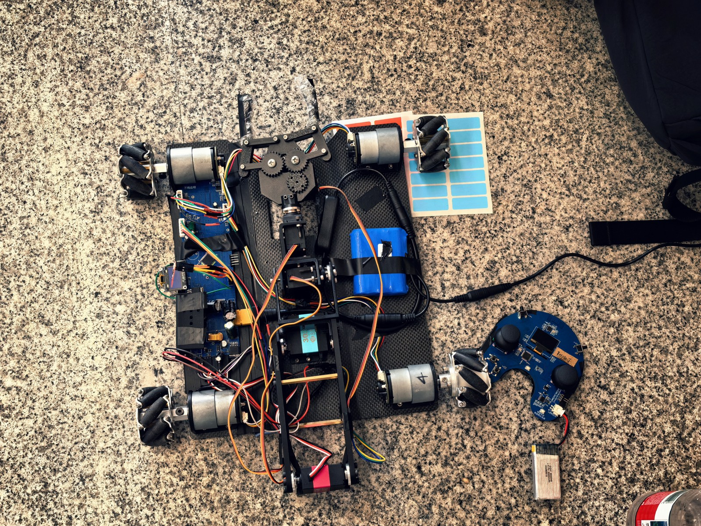
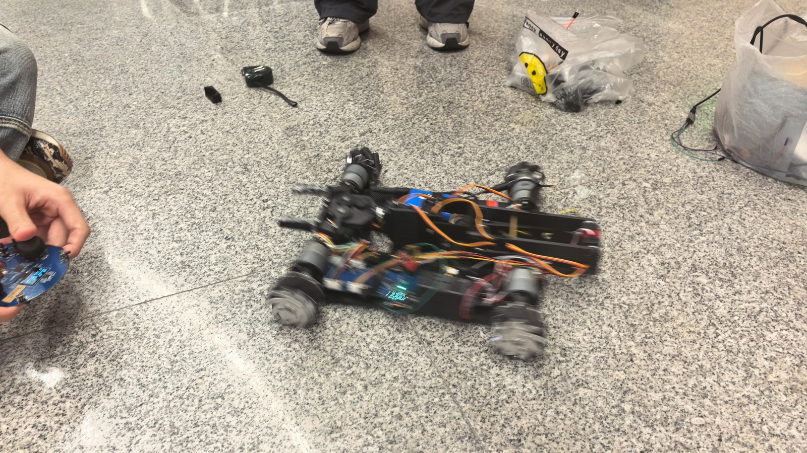
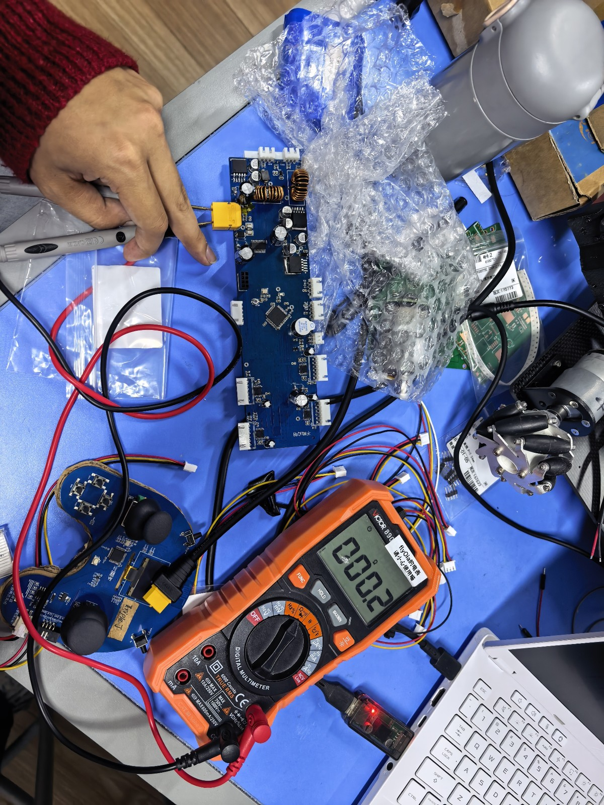
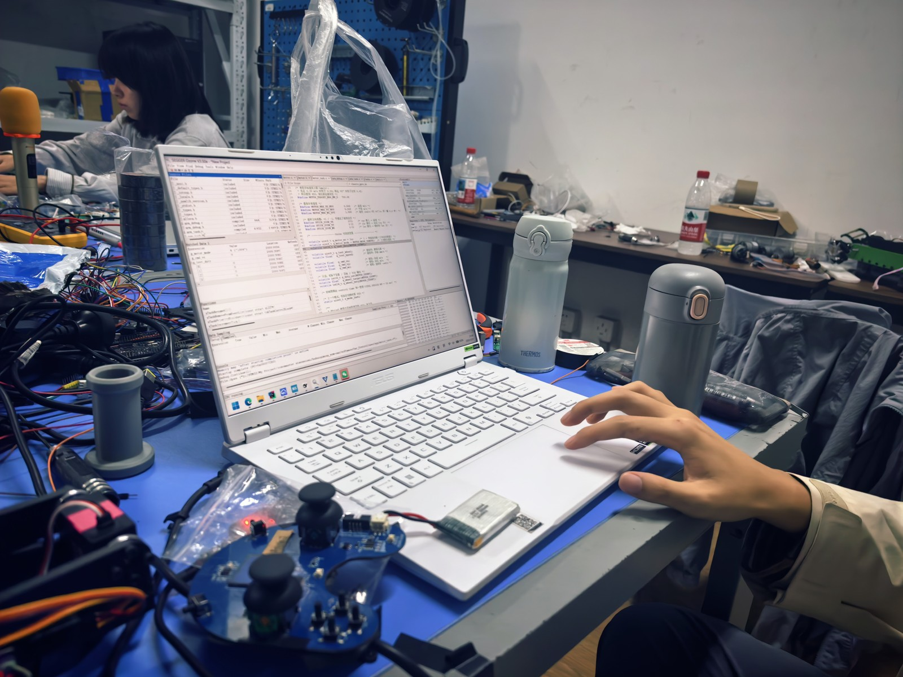
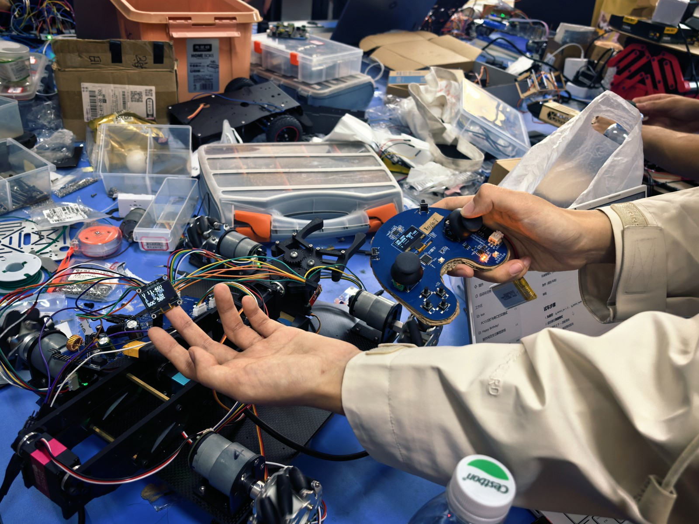
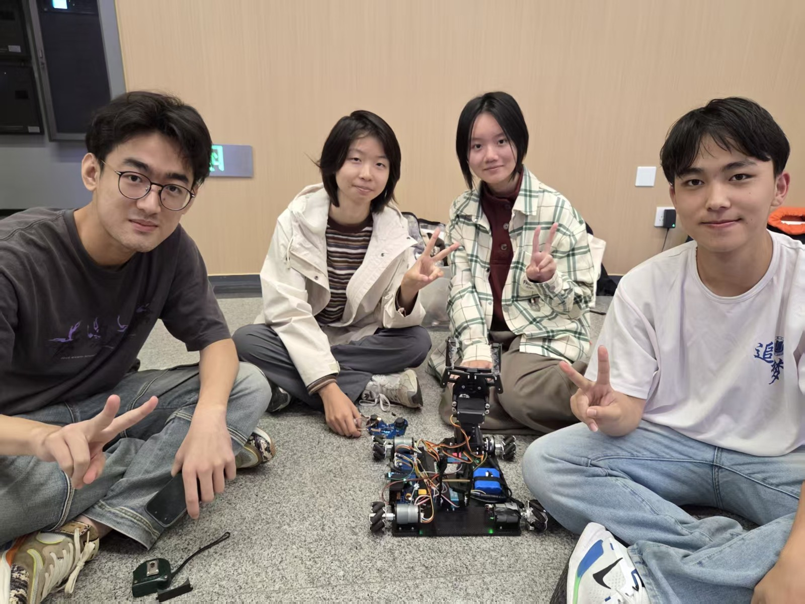
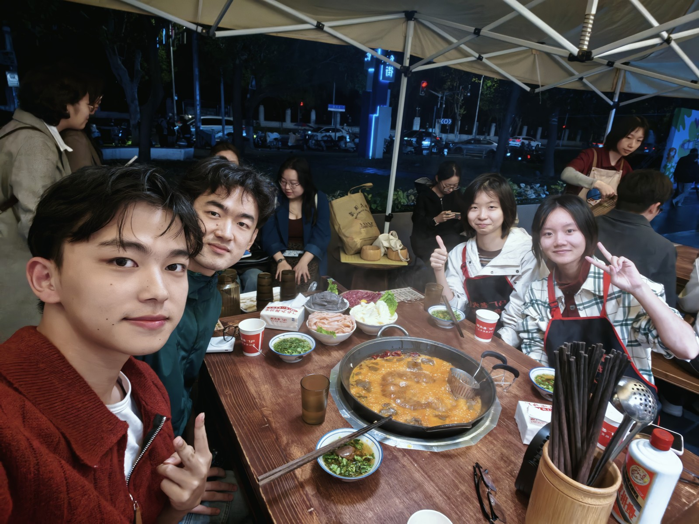
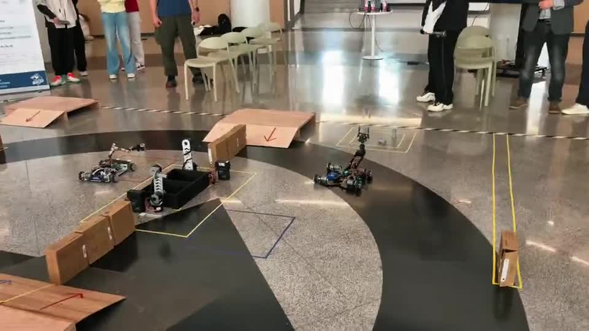
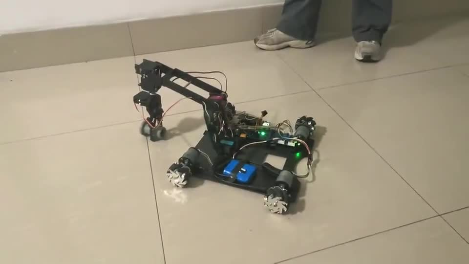

# 照片与演示

[返回最终交付](最终交付.md)

## 整车与调试

## 团队记录

照片由队伍提供，不从画面推断成员身份或GitHub账号对应关系。

## 视频

以下是队伍原视频的压缩浏览版，保留完整时序，没有添加成功判定字幕。GitHub页面若不内嵌播放，可点击下载后本地播放。

### 比赛：二级兑矿

[下载/播放比赛视频](../assets/videos/competition-level2.mp4)

队伍确认比赛完成过二级兑矿，原文件名为“比赛时候二级兑矿.mp4”。

### 练习

[下载/播放练习视频](../assets/videos/practice.mp4)

队伍确认练习时完成过三级兑矿；本视频原文件名为“练习.mp4”，不额外推断每个动作对应的级别或裁判结果。
