# 硬件图文交付

[返回最终交付](最终交付.md)

实际参赛A板，B版仅备用。下图从交付PPT提取，不等于包含全部返修、飞线和替代料的最终制造文件。原图中的2mΩ等历史标注未改图；最终采样电阻已确认为3mΩ。

## 主控与遥控

车控STM32F103RCT6，遥控STM32F103C8T6。SWD用于下载调试，UART用于日志，二者不是同一接口。

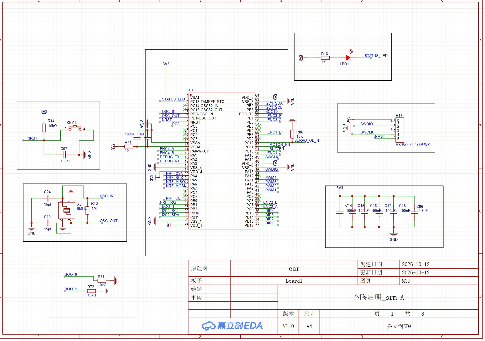

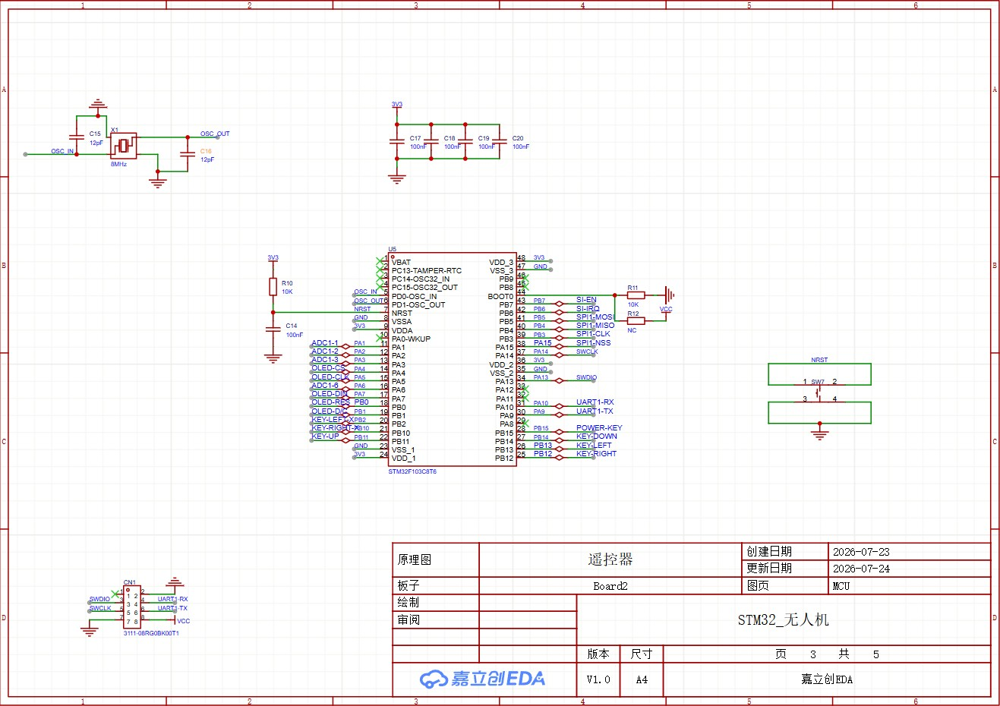

## 电源与测量

12V母线供电机驱动、两路XL4015及逻辑降压。LM2596产生5V，AP2112K产生3.3V；INA226检测电池电压及采样电阻压降。最终采样电阻3mΩ。

两路舵机电源分担负载，不应把两路稳压正极直接并联。比赛无线从调试模块外接3.3V，复现前需核对隔离和共地；不要让独立稳压输出直接互接。

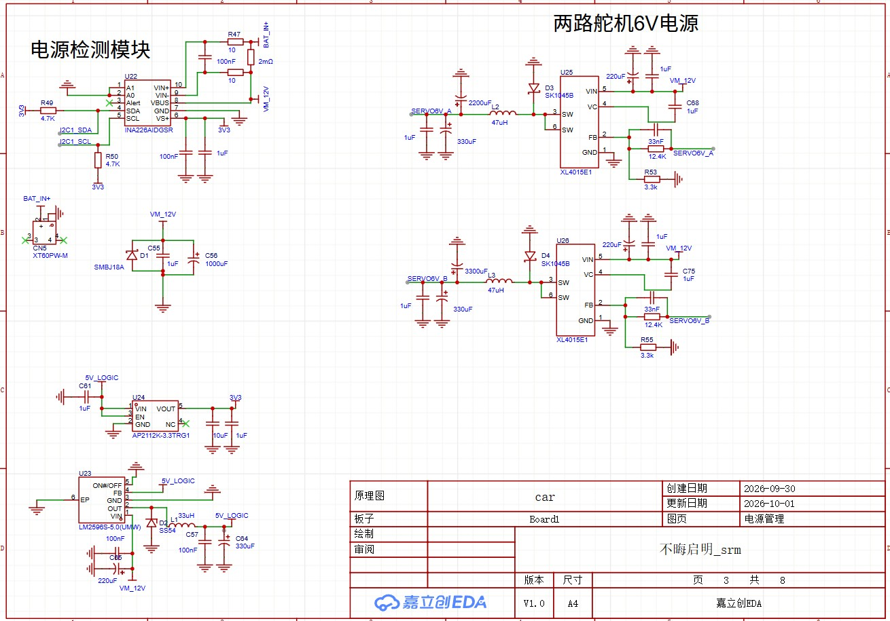

## 电机驱动

四路DRV8874分别控制四台底盘电机，编码器反馈给主控。能够转动不代替功率路径、启动电流和温升验证；A版曾发现输出细线及换层瓶颈，原版图不应直接视为已完成载流校核。

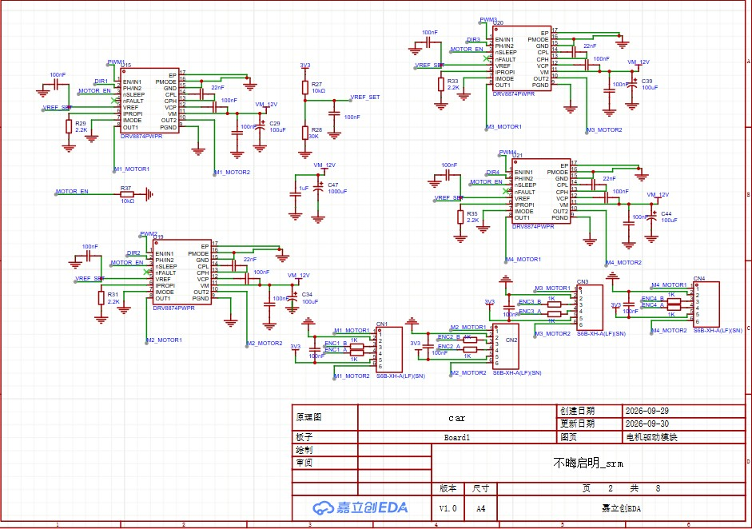

## 舵机控制

PCA9685经I²C2与车控连接，控制30kg、25kg及3只MG945舵机，产生五路PWM；舵机功率来自两路约6V电源，不能从PCA逻辑VDD给舵机供电。OE禁止输出并不等于切断舵机电源。I²C不稳定最终通过重焊SDA上拉电阻处理。

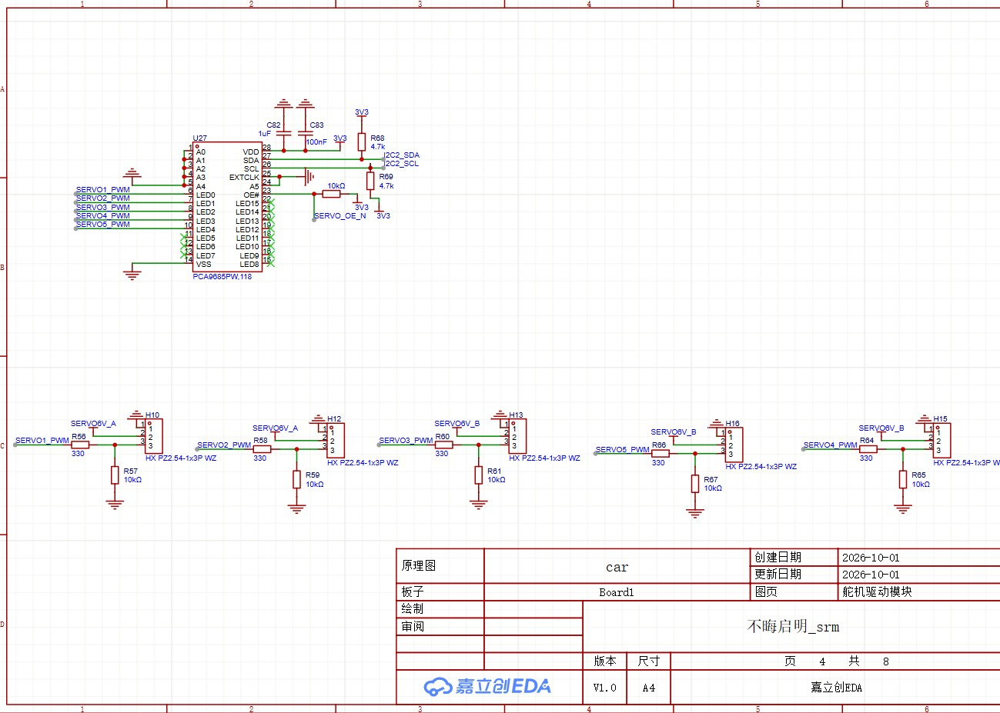

## 无线、显示与调试

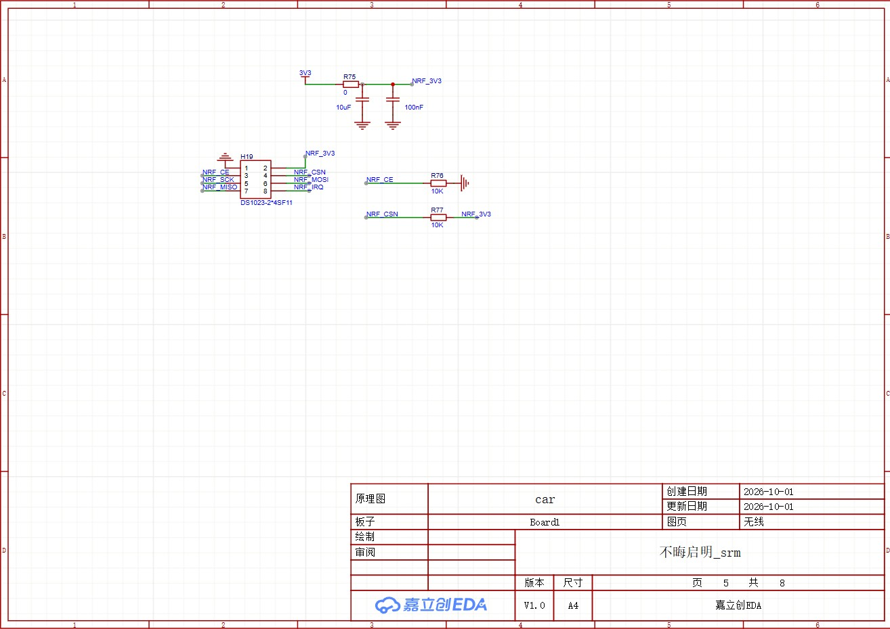

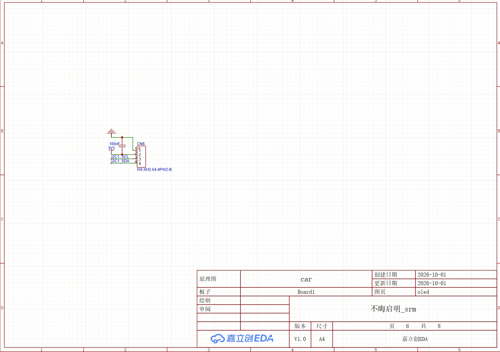

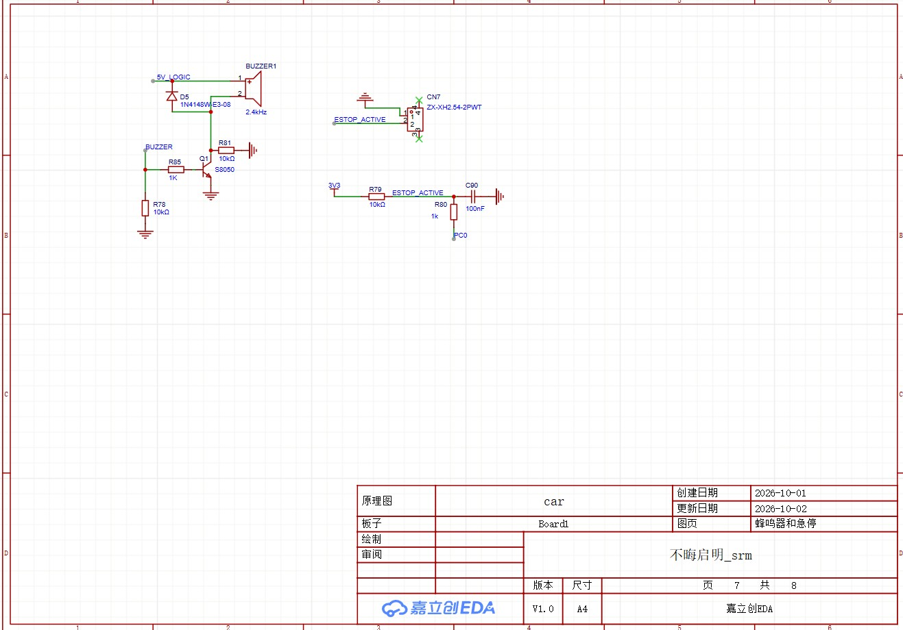

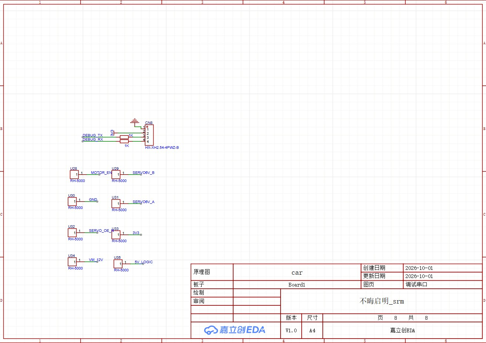

以上是电路设计。队伍已确认板载急停按键和蜂鸣器最终未安装，因此SafetyTask未编写；遥控急停功能仍保留。停止策略、失联恢复行为以车控源码和实机为准，不能把图中的本地物理急停视为已安装。

## PCB与接口

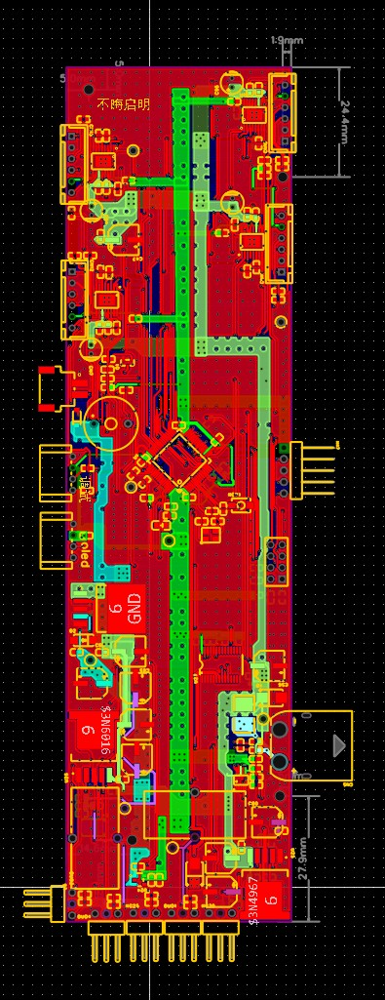

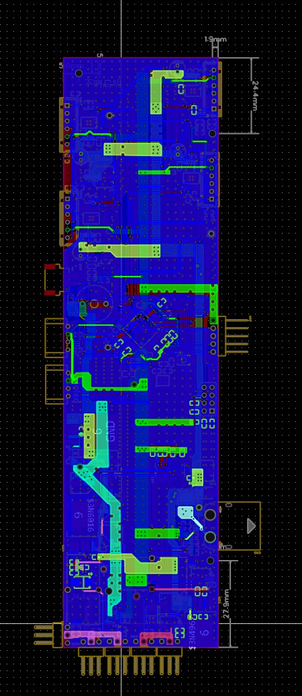

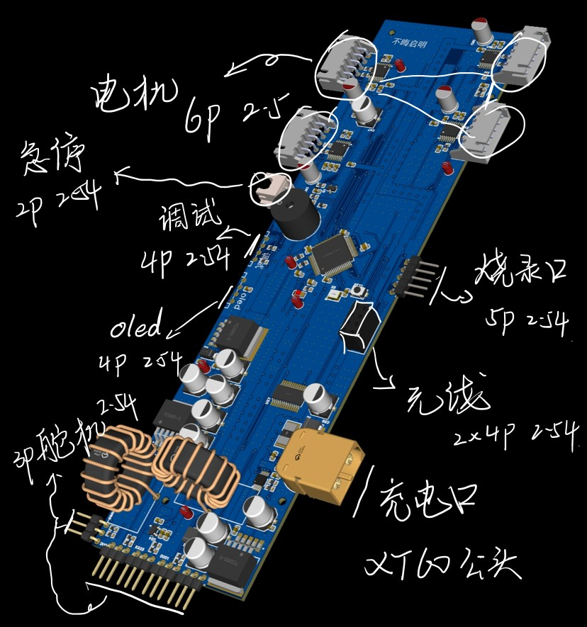

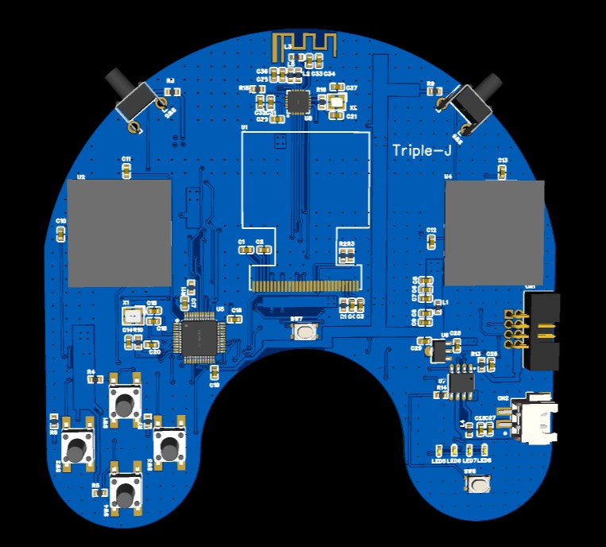

## BOM与复现边界

现有[历史BOM](../bom/README.md)存在功率电感通用封装、大电容型号与容量冲突、采样电阻版本差异。不能直接按旧表采购并保证复现参赛实物。最终电容容量/耐压和补强线仍待补充核对。B版EDA工程已归档，未经验证，不能直接作为已验证制造方案。

## A / B版本文件

- [参赛A版原理图与PCB](../hardware/A-competition/A版_原理图与PCB.docx)
- [备用B版工程及状态说明](../hardware/B-unverified/)

B版主要将元器件布置得更紧密、扩大电源铺铜，未用于比赛，未开展实机验证。布局调整本身不证明载流、温升或通信可靠性已经通过测试。
